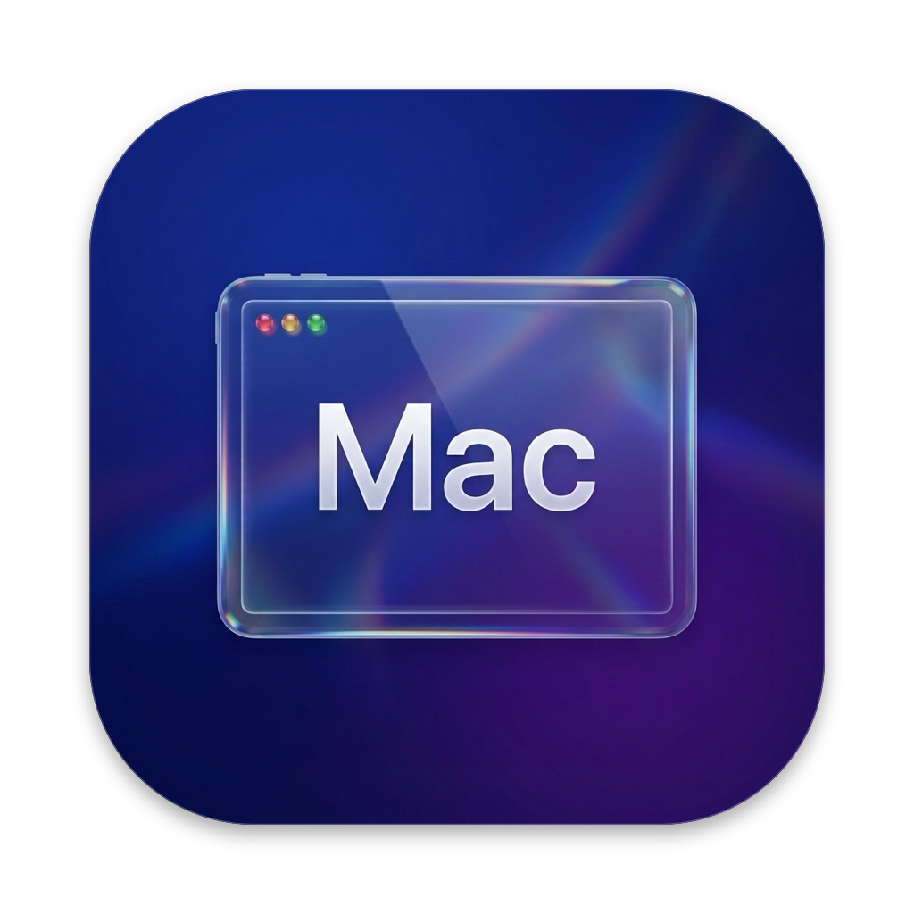

<div align="center">
  <a href="https://github.com/MakeDieOrz/MacOver">
    
  </a>

  <h1>MacOver</h1>

  <p>
    <em>Fake it till you Mac it.</em><br />
    Apple Silicon Mac（macOS 26 以降）で復号済み ARM64 iOS アプリ・ゲームをネイティブ動作させるランチャー。
  </p>

  <p>
    <a href="https://github.com/MakeDieOrz/MacOver/actions/workflows/ci.yml">
      
    </a>
    <a href="https://github.com/MakeDieOrz/MacOver/releases">
      
    </a>
    <a href="./LICENSE">
      
    </a>
    
  </p>

  <p>
    <a href="https://github.com/MakeDieOrz/MacOver/releases">Releases</a>
    ·
    <a href="https://github.com/MakeDieOrz/MacOver/issues">Issues</a>
    ·
    <a href="./PlayTools/README.md">PlayTools 技術ドキュメント (EN)</a>
    <br />
    <a href="./README.md">English</a>
    ·
    <a href="./README.zh-CN.md">简体中文</a>
    ·
    <strong>日本語</strong>
  </p>
</div>

MacOver は [PlayCover](https://github.com/PlayCover/PlayCover) および [PlayTools](https://github.com/PlayCover/PlayTools) を土台に、**Apple Silicon + macOS 26 Tahoe 以降**向けに UI・コンテナ分離・ランタイム仮想化・ビルド構成を全面的に作り直したフォークです。

CPU エミュレーションを使わず Mac Catalyst と注入ランタイム `PlayTools` で ARM64 バイナリをそのまま実行するため、ネイティブに近いパフォーマンスを維持したまま、キーマッピング・マウス/コントローラー操作・表示解像度やフレームレート制御・アプリ単位のネットワーク制御・独立キーチェーン（`PlayChain`）が使えます。


## 本家 PlayCover との違い

| 項目 | 本家 PlayCover | MacOver |
| --- | --- | --- |
| **UI と macOS 対応** | 旧 SwiftUI レイアウト、モーダルで UI がブロックされやすい | macOS 26+ の Liquid Glass（`GlassEffectContainer`）でライブラリ・設定画面・ライブプレビュー・プリセット・GPU ピクセル予算メーターを再設計。アラートも非同期キューの Sheet 化 |
| **共存性とデータ分離** | `io.playcover.PlayCover` と共通パス `~/Library/Frameworks/PlayTools.framework` を占有 | `app.makedie.MacOver` 配下に完全分離。`PlayTools.framework` も `~/Library/Containers/app.makedie.MacOver/Frameworks/` へ独立配置し、`KeyCover` / `PlayChain` / `app.makedie.MacOver.Helper` も別管理。**既存の PlayCover 環境を上書きしません** |
| **ランタイム仮想化と検出回避** | 基本的な `PlayTools` フック中心 | C/ObjC 層の FS・dyld・システム情報仮想化（`PTFSVirtualizer`、`PTDyldVirtualizer`、`PTSystemSpoofer`）を強化。MacOver・PlayCover 両方の痕跡を隠蔽し、macOS 26/27 向けの `reportedIOSVersion` 偽装、ダイレクトタッチ操作、マルチウィンドウ座標ルーティング、アプリ別 URL ブロックに対応 |
| **クラッシュ復旧とプラグイン** | 起動時クラッシュは手動対処、dylib 管理は最小限 | 起動 3 秒以内の異常終了を検知して次回自動でセーフモード起動する `PTSafeMode` を搭載。`UserPlugins` は `PluginManifest.json` 検証＋動的隠蔽登録（`PTRegistration`）に対応。移行前自動バックアップ（`PlayedAppleDBBackup`）と `PLAYTOOLS_DEBUG_LOG=1` のシステムコール追跡も利用可能 |
| **リポジトリとビルド** | PlayCover / PlayTools が別リポジトリで Carthage や外部パッチが必要 | モノレポ統合済み。`PlayCover.xcworkspace` だけで `MacOver.app`・`PlayCoverHelper`・`PlayTools.framework`・`AKInterface.bundle`・外部依存ゼロの SwiftPM 群（`Packages/PlayCoverModules`）を一括ビルド |
| **権限昇格と自動テスト** | ヘルパー運用に有料署名が前提、テスト整備が限定的 | 署名済みビルドでは `SMAppService` 経由の XPC Helper、Ad-hoc ビルドでは AppleScript 昇格へ自動フォールバック。ユニットテスト 121 件・Clang 静的解析 0 警告・ヘッドレス Catalyst 実行ハーネスを CI で検証 |

## インストール

### 動作環境

- **Apple Silicon Mac**（M1 以降）。Intel Mac は非対応です。
- **macOS 26.0 Tahoe 以降**。

### ダウンロード

[GitHub Releases](https://github.com/MakeDieOrz/MacOver/releases) から最新の `.dmg` をダウンロードし、`MacOver.app` を `/Applications` にドラッグしてください。

> **Ad-hoc 署名ビルドについて**: 配布 DMG は Apple 公証なしの Ad-hoc 署名です。初回起動時に「壊れている」「開発元を確認できない」と表示された場合は、隔離属性を外してから起動してください。
> ```sh
> xattr -cr /Applications/MacOver.app
> ```

### 既存の PlayCover との共存

アプリ本体・設定・キーマップ・`PlayChain`・`PlayTools.framework` はすべて `~/Library/Containers/app.makedie.MacOver/` 内に収まるため、MacOver を入れても既存の PlayCover や `~/Library/Frameworks/PlayTools.framework` を壊しません。

ただし macOS の仕様上、**同じ iOS の Bundle ID** はシステム側のサンドボックス（`~/Library/Containers/<BundleID>`）と LaunchServices 登録を共有します。同じアプリを PlayCover と MacOver の両方に入れて交互に起動するのは避けてください。

## ソースからのビルドとテスト

Xcode（macOS 26 SDK 以降）が必要です。ヘッドレス実行ハーネスを回す場合は Python 3 も用意してください。

`PlayCover.xcworkspace` を Xcode で開くか、リポジトリ直下で以下を実行します（`xcode-select` が CommandLineTools を向いている環境では `DEVELOPER_DIR` を付けたまま実行してください）。

```sh
# 1. オフライン SwiftPM モジュールテスト（PlayCoverCore / PlayCoverMachO / PlayCoverSandbox / PlayCoverUI）
DEVELOPER_DIR=/Applications/Xcode.app/Contents/Developer swift test --package-path Packages/PlayCoverModules

# 2. Xcode テストスイート全体（PlayCoverMachOTests / PlayCoverCoreTests / PlayToolsTests）
DEVELOPER_DIR=/Applications/Xcode.app/Contents/Developer xcodebuild \
  -workspace PlayCover.xcworkspace \
  -scheme PlayCoverTests \
  -configuration Debug \
  CODE_SIGN_IDENTITY=- CODE_SIGNING_REQUIRED=NO \
  test

# 3. Release 版 MacOver.app のビルド（PlayCoverHelper と PlayTools.framework を同梱）
DEVELOPER_DIR=/Applications/Xcode.app/Contents/Developer xcodebuild \
  -workspace PlayCover.xcworkspace \
  -scheme PlayCover \
  -configuration Release \
  CODE_SIGN_IDENTITY=- CODE_SIGNING_REQUIRED=NO CODE_SIGN_STYLE=Manual \
  build

# 4. PlayTools のフォーマット検証と Clang Static Analyzer
DEVELOPER_DIR=/Applications/Xcode.app/Contents/Developer ./ci/run_static_analysis.sh --check-format

# 5. ビルド済み PlayTools.framework に対する Mac Catalyst 実機注入・Safe Mode 検証
python3 Tests/RuntimeHarness/run_runtime_harness.py \
  --playtools-framework <path/to/MacOver.app/Contents/Frameworks/PlayTools.framework> \
  --verbose
```

### 関連ドキュメント

- `PlayTools` のフック仕様・Safe Mode・`PluginManifest.json`・`PLAYTOOLS_DEBUG_LOG=1` トレース：[PlayTools/README.md](./PlayTools/README.md)（[简体中文](./PlayTools/README.zh-CN.md)）
- ホスト側ワークスペースとモジュール構成：[PlayCover/Documentation.docc/Documentation.md](./PlayCover/Documentation.docc/Documentation.md)

## ライセンス

本リポジトリは、上流 PlayCover 由来の互換性のある 2 つのコピーレフトライセンス構成を引き継いでいます。

- **ホストアプリ・SwiftPM モジュール（`MacOver`、[`PlayCover/PlayCover`](https://github.com/PlayCover/PlayCover) 派生）**：**GPL-3.0**（[LICENSE](./LICENSE)）
- **注入ランタイム（`PlayTools/`、[`PlayCover/PlayTools@e222ce0`](https://github.com/PlayCover/PlayTools) 派生）**：**AGPL-3.0**（[PlayTools/LICENSE](./PlayTools/LICENSE)）

`PlayTools.framework` を同梱した `MacOver.app` などの結合バイナリを再配布する場合は、GPL-3.0 第 13 条および AGPL-3.0 第 13 条に従います。

## クレジット・使用ライブラリ

本プロジェクトは [PlayCover](https://github.com/PlayCover/PlayCover) コミュニティの成果をベースにしています。

- Lucas Lee — playcover@lucas.icu
- Depal — depal@playcover.io
- PlayCover のオリジナル開発者 @iVoider 氏に感謝します。

使用している主なライブラリ：

- [PTFakeTouch](https://github.com/Ret70/PTFakeTouch)
- [DownloadManager](https://github.com/shapedbyiris/download-manager)
- [DataCache](https://github.com/huynguyencong/DataCache)
- [SwiftUI CachedAsyncImage](https://github.com/bullinnyc/CachedAsyncImage)
- [Yams](https://github.com/jpsim/Yams)
- [SwiftSoup](https://github.com/scinfu/SwiftSoup)
- [Sparkle](https://github.com/sparkle-project/Sparkle)
- [SwordRPC](https://github.com/spotlightishere/SwordRPC)
- [inject](https://github.com/paradiseduo/inject) *（初期の Mach-O 注入設計の参考。MacOver では独自の `PlayCoverMachO` を使用）*
