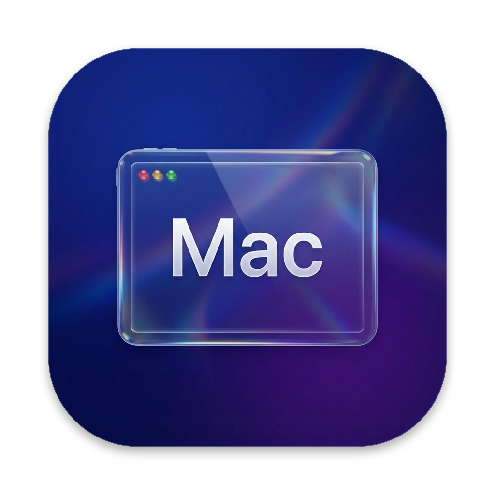

<div id="top"></div>

‎<h1 align="center">[![Contributors][contributors-shield]][contributors-url]
[![Forks][forks-shield]][forks-url]
[![Stargazers][stars-shield]][stars-url]
[![Issues][issues-shield]][issues-url]
[![GPLv3 License][license-shield]][license-url]
[](https://hosted.weblate.org/projects/playcover/playcover/)
</h1>


<!-- PROJECT LOGO -->
<br />
<div align="center">
  <a href="https://github.com/PlayCover/PlayCover">
    
  </a>

  <h3 align="center">PlayCover</h3>

  <p align="center">
    Run iOS apps and games on Apple Silicon Macs with mouse, keyboard and controller support.
    <br />
    <br />
    <a href="https://playcover.github.io/PlayBook">Documentation</a>
    ·
    <a href="https://discord.gg/RNCHsQHr3S">Discord</a>
    ·
    <a href="https://playcover.io/">Website</a>
    <br />
    <strong>English</strong>
    ·
    <a href="./README.zh-CN.md">简体中文</a>
  </p>
</div>

<!-- ABOUT THE PROJECT -->
## About The Project

Welcome to PlayCover 5.0! PlayCover enables you to run iOS apps and games natively on Apple Silicon Macs running macOS 12.0 Monterey through macOS 15 Sequoia (and newer).

PlayCover works by wrapping iOS binaries as Mac Catalyst apps and injecting `PlayTools`, preserving native ARM64 performance while bridging display scaling, input controls, and mobile runtime APIs.

PlayCover also allows you to map custom touch controls to keyboard, mouse, trackpad, and game controllers—including WASD movement, camera control, left/right clicks, and individual keymapping—beyond what standard sideloading methods offer.

### What's New in PlayCover 5.0

- **Unified Workspace & Zero-Patch Build**: `PlayCover`, `PlayCoverHelper`, `PlayTools` (`PlayTools.framework` + `AKInterface.bundle`), and `Packages/PlayCoverModules` build together natively inside `PlayCover.xcworkspace` without Carthage or external patch diffs.
- **Modular SwiftPM Architecture**: Pure core, Mach-O/PlayTools injection, keymapping, sandbox/helper security, and UI presentation components live in `Packages/PlayCoverModules` (`PlayCoverCore`, `PlayCoverMachO`, `PlayCoverKeymapping`, `PlayCoverSandbox`, `PlayCoverUI`) with zero external third-party package dependencies.
- **Structured Dependency Injection & Async UI**: App-wide state is wired explicitly through `PlayCoverDependencies` (removing global `static shared` singletons) paired with non-blocking async SwiftUI alert sheets (`AlertPresenter`).
- **Dual-Track Privilege Escalation**: Supports a hardened `PlayCoverHelper` privileged XPC daemon (`SMAppService` on macOS 13+ when signed with Developer ID) with automatic AppleScript administrator fallback for local/ad-hoc builds.
- **Safe Mode, Manifest Plugins & Tracing**: Automatic early-crash recovery (`PTSafeMode`), `PluginManifest.json`-driven `UserPlugins` with dynamic anti-detection registration (`PTRegistration`), macOS 15 Sequoia `AKInterface` window geometry bridging, pre-migration `PlayedAppleDBBackup`, and `PLAYTOOLS_DEBUG_LOG=1` C/ObjC syscall tracing.

Localisations are handled in [Weblate](https://hosted.weblate.org/projects/playcover/).


<p align="right"><a href="#top">⬆️ Back to top️</a></p>

<!-- GETTING STARTED -->
## Getting Started

Follow the instructions below to get started with PlayCover on Apple Silicon Macs.

### Prerequisites

- **Apple Silicon Mac** (M-series SoC) running **macOS 12.0 Monterey or newer** (tested on macOS 14 Sonoma and macOS 15 Sequoia). Intel Macs are not supported; explore Bootcamp or emulators instead.
- **Building from source**: Xcode (Swift 5.9+ toolchain) and Python 3 (optional, for the headless runtime harness).

### Download

You can download stable releases [here](https://github.com/PlayCover/PlayCover/releases), or build from source using the commands below.

### Documentation

To learn how to set up and use PlayCover, visit the documentation [here](https://playcover.github.io/PlayBook), or see [PlayTools/README.md](./PlayTools/README.md) for runtime hook, plugin, and Safe Mode internals.

### Homebrew Cask
We host a [Homebrew](https://brew.sh) tap with the [PlayCover cask](https://github.com/PlayCover/homebrew-playcover/blob/master/Casks/playcover-community.rb). To install from it run:

```sh
brew install --cask PlayCover/playcover/playcover-community
```

To uninstall:
1. Remove PlayCover using `brew uninstall --cask playcover-community`;
2. Untap `PlayCover/playcover` with `brew untap PlayCover/playcover`.

### Building & Testing from Source (5.0)

Open `PlayCover.xcworkspace` in Xcode, or run the full verification suite from the repository root (if `xcode-select` points to CommandLineTools, keep `DEVELOPER_DIR=/Applications/Xcode.app/Contents/Developer`):

```sh
# 1. Run offline modular SwiftPM tests (PlayCoverCore, PlayCoverMachO, PlayCoverSandbox, PlayCoverUI)
DEVELOPER_DIR=/Applications/Xcode.app/Contents/Developer swift test --package-path Packages/PlayCoverModules

# 2. Run full Xcode test suite (PlayCoverMachOTests, PlayCoverCoreTests, PlayToolsTests)
DEVELOPER_DIR=/Applications/Xcode.app/Contents/Developer xcodebuild \
  -workspace PlayCover.xcworkspace \
  -scheme PlayCoverTests \
  -configuration Debug \
  CODE_SIGN_IDENTITY=- CODE_SIGNING_REQUIRED=NO CODE_SIGNING_ALLOWED=NO \
  test

# 3. Build Release app bundle (embeds PlayCoverHelper & PlayTools.framework)
DEVELOPER_DIR=/Applications/Xcode.app/Contents/Developer xcodebuild \
  -workspace PlayCover.xcworkspace \
  -scheme PlayCover \
  -configuration Release \
  CODE_SIGN_IDENTITY=- CODE_SIGNING_REQUIRED=NO CODE_SIGNING_ALLOWED=NO \
  build

# 4. Run clang-format / .clang-tidy config check + Clang Static Analyzer on PlayTools
DEVELOPER_DIR=/Applications/Xcode.app/Contents/Developer ./ci/run_static_analysis.sh --check-format

# 5. Run live Mac Catalyst runtime harness against built PlayTools.framework
python3 Tests/RuntimeHarness/run_runtime_harness.py \
  --playtools-framework <path/to/PlayTools.framework> \
  --verbose
```

<p align="right"><a href="#top">⬆️ Back to top️</a></p>


<!-- LICENSE -->
## License

Distributed under the GPLv3 License. See `LICENSE` for more information.


<!-- CONTACT -->
## Contact

Lucas Lee - playcover@lucas.icu

Depal - depal@playcover.io


<!-- ACKNOWLEDGMENTS -->
## Libraries Used

These open source libraries are used in PlayCover 5.0:

* [PTFakeTouch](https://github.com/Ret70/PTFakeTouch)
* [DownloadManager](https://github.com/shapedbyiris/download-manager)
* [DataCache](https://github.com/huynguyencong/DataCache)
* [SwiftUI CachedAsyncImage](https://github.com/bullinnyc/CachedAsyncImage)
* [Yams](https://github.com/jpsim/Yams)
* [SwiftSoup](https://github.com/scinfu/SwiftSoup)
* [Sparkle](https://github.com/sparkle-project/Sparkle)
* [SwordRPC](https://github.com/spotlightishere/SwordRPC)
* [inject](https://github.com/paradiseduo/inject) *(original Mach-O injection inspiration; PlayCover 5.0 uses native `PlayCoverMachO`)*

* Thanks to @iVoider for creating such a great project!

<p align="right"><a href="#top">⬆️ Back to top️</a></p>


<!-- MARKDOWN LINKS & IMAGES -->
[contributors-shield]: https://img.shields.io/github/contributors/PlayCover/PlayCover.svg?style=for-the-badge
[contributors-url]: https://github.com/PlayCover/PlayCover/graphs/contributors
[forks-shield]: https://img.shields.io/github/forks/PlayCover/PlayCover.svg?style=for-the-badge
[forks-url]: https://github.com/PlayCover/PlayCover/network/members
[stars-shield]: https://img.shields.io/github/stars/PlayCover/PlayCover.svg?style=for-the-badge
[stars-url]: https://github.com/PlayCover/PlayCover/stargazers
[issues-shield]: https://img.shields.io/github/issues/PlayCover/PlayCover.svg?style=for-the-badge
[issues-url]: https://github.com/PlayCover/PlayCover/issues
[license-shield]: https://img.shields.io/github/license/PlayCover/PlayCover.svg?style=for-the-badge
[license-url]: https://github.com/PlayCover/PlayCover/blob/master/LICENSE
