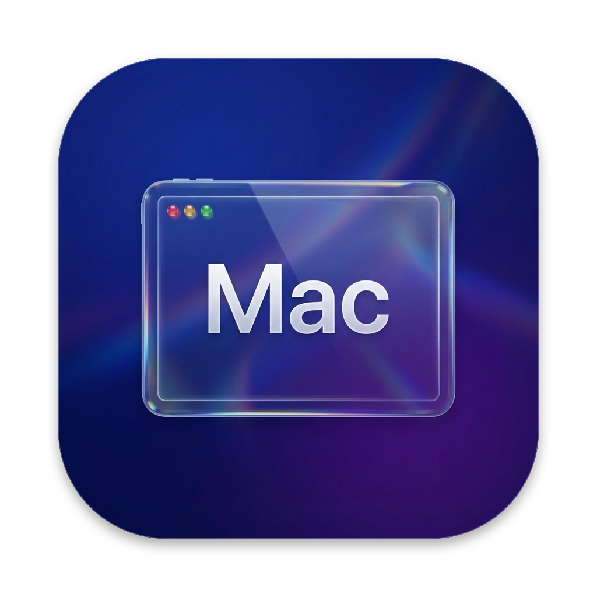

<div align="center">
  <a href="https://github.com/MakeDieOrz/MacOver">
    
  </a>

  <h1>MacOver</h1>

  <p>
    <em>Fake it till you Mac it.</em><br />
    在 Apple Silicon Mac（macOS 26+）上原生运行解密后的 ARM64 iOS 应用与游戏。
  </p>

  <p>
    <a href="https://github.com/MakeDieOrz/MacOver/actions/workflows/ci.yml">
      
    </a>
    <a href="https://github.com/MakeDieOrz/MacOver/releases">
      
    </a>
    <a href="./LICENSE">
      
    </a>
    
  </p>

  <p>
    <a href="https://github.com/MakeDieOrz/MacOver/releases">下载发布版</a>
    ·
    <a href="https://github.com/MakeDieOrz/MacOver/issues">提交问题</a>
    ·
    <a href="./PlayTools/README.zh-CN.md">PlayTools 运行时文档</a>
    <br />
    <a href="./README.md">English</a>
    ·
    <strong>简体中文</strong>
    ·
    <a href="./README.ja.md">日本語</a>
  </p>
</div>

MacOver 是基于 [PlayCover](https://github.com/PlayCover/PlayCover) 和 [PlayTools](https://github.com/PlayCover/PlayTools) 深度重构的衍生分支，专门面向 **Apple Silicon + macOS 26 Tahoe 及更新系统**。

原理上依旧走 Mac Catalyst + 注入 `PlayTools` 原生执行 ARM64 代码，不经过指令集模拟，跑起来接近原生性能；在此基础上把界面、容器隔离、运行时反检测、崩溃兜底和工程构建整套重写了一遍。


## 和原版 PlayCover 有什么区别？

| 对比维度 | 原版 PlayCover | MacOver |
| --- | --- | --- |
| **界面与系统适配** | 旧版 SwiftUI 布局，弹窗容易阻塞主线程 | 按 macOS 26+ 原生 Liquid Glass（`GlassEffectContainer`）重写应用库、配置栏、实时预览、场景预设和 GPU 像素预算条，弹窗改为队列式异步 Sheet |
| **多版本共存隔离** | 固定占用 `io.playcover.PlayCover` 和全局 `~/Library/Frameworks/PlayTools.framework` | 整套独立在 `app.makedie.MacOver` 下，连 `PlayTools.framework` 也放在自己的 `~/Library/Containers/app.makedie.MacOver/Frameworks/` 里，另配独立 `KeyCover`、`PlayChain` 和 `app.makedie.MacOver.Helper`，**装 MacOver 不会把原来的 PlayCover 覆盖坏** |
| **反检测与系统虚拟化** | 基础版 `PlayTools` Hook | 重写加固的 C/ObjC 文件系统、dyld 和系统属性虚拟化（`PTFSVirtualizer`、`PTDyldVirtualizer`、`PTSystemSpoofer`），同时隐藏 MacOver 与 PlayCover 路径痕迹；支持针对 macOS 26/27 自定义 `reportedIOSVersion`；新增鼠标直触、多窗口命中路由以及按应用生效的 URL 网络规则 |
| **稳定性与插件机制** | 启动闪退只能手动排查，dylib 注入缺少校验 | 内置 `PTSafeMode`，3 秒内启动崩溃后下次自动进安全模式避开死循环；`UserPlugins` 引入 `PluginManifest.json` 校验与动态模块隐藏注册（`PTRegistration`）；旧数据库升级前由 `PlayedAppleDBBackup` 自动快照；支持 `PLAYTOOLS_DEBUG_LOG=1` 抓系统调用追踪 |
| **源码结构与构建** | PlayCover / PlayTools 分仓库维护，依赖 Carthage 和手工补丁 | 单仓库一体化：`PlayCover.xcworkspace` 直接编出 `MacOver.app`、`PlayCoverHelper`、`PlayTools.framework`、`AKInterface.bundle` 和零第三方依赖的 SwiftPM 模块（`Packages/PlayCoverModules`） |
| **提权方式与测试覆盖** | 特权工具依赖正式签名，自动化测试薄弱 | 双轨提权：有 Developer ID 签名走 `SMAppService` XPC Helper，本地/Ad-hoc 签名自动回退 AppleScript 提权；配套 121 项单元测试、Clang 静态分析 0 告警及无头 Mac Catalyst 运行时实测套件 |

## 安装与使用

### 环境要求

- **Apple Silicon Mac**（M1 及以上），不支持 Intel Mac。
- **macOS 26.0 Tahoe 及以上**。

### 下载安装

前往 [GitHub Releases](https://github.com/MakeDieOrz/MacOver/releases) 下载最新 `.dmg`，打开后把 `MacOver.app` 拖进 `/Applications`。

> **Ad-hoc 签名提示**：当前 Release 包使用本地 Ad-hoc 签名，未经过苹果公证。首次打开若提示“已损坏”或“无法验证开发者”，在终端清掉隔离属性后重新打开即可：
> ```sh
> xattr -cr /Applications/MacOver.app
> ```

### 与原版 PlayCover 共存说明

MacOver 把已安装应用、配置、键位、`PlayChain` 和 `PlayTools.framework` 全部收在 `~/Library/Containers/app.makedie.MacOver/` 内，启动 MacOver 不会碰原版 PlayCover 的 `~/Library/Frameworks/PlayTools.framework` 或旧容器数据。

唯一受限于 macOS 自身机制的是：**同一个 iOS Bundle ID** 在系统里只对应一份沙盒数据目录（`~/Library/Containers/<BundleID>`）和 LaunchServices 注册项，所以不要把同一个应用同时在 PlayCover 和 MacOver 里混着开。

## 从源码构建与测试

需要 Xcode（macOS 26 SDK 或更新版本），运行无头运行时测试还需 Python 3。

可以直接用 Xcode 打开 `PlayCover.xcworkspace`，也可以在仓库根目录用命令行跑（如果本机 `xcode-select` 指向 CommandLineTools，请保留 `DEVELOPER_DIR`）：

```sh
# 1. 运行离线 SwiftPM 模块单测（PlayCoverCore / PlayCoverMachO / PlayCoverSandbox / PlayCoverUI）
DEVELOPER_DIR=/Applications/Xcode.app/Contents/Developer swift test --package-path Packages/PlayCoverModules

# 2. 运行完整 Xcode 单元测试（PlayCoverMachOTests / PlayCoverCoreTests / PlayToolsTests）
DEVELOPER_DIR=/Applications/Xcode.app/Contents/Developer xcodebuild \
  -workspace PlayCover.xcworkspace \
  -scheme PlayCoverTests \
  -configuration Debug \
  CODE_SIGN_IDENTITY=- CODE_SIGNING_REQUIRED=NO \
  test

# 3. 编译 Release 版 MacOver.app（自动打包 PlayCoverHelper 与 PlayTools.framework）
DEVELOPER_DIR=/Applications/Xcode.app/Contents/Developer xcodebuild \
  -workspace PlayCover.xcworkspace \
  -scheme PlayCover \
  -configuration Release \
  CODE_SIGN_IDENTITY=- CODE_SIGNING_REQUIRED=NO CODE_SIGN_STYLE=Manual \
  build

# 4. 对 PlayTools 运行代码格式检查与 Clang 静态分析
DEVELOPER_DIR=/Applications/Xcode.app/Contents/Developer ./ci/run_static_analysis.sh --check-format

# 5. 对编好的 PlayTools.framework 跑真实 Mac Catalyst 注入与安全模式测试
python3 Tests/RuntimeHarness/run_runtime_harness.py \
  --playtools-framework <path/to/MacOver.app/Contents/Frameworks/PlayTools.framework> \
  --verbose
```

### 更多文档

- `PlayTools` 运行时 Hook、安全模式、`PluginManifest.json` 插件规范和 `PLAYTOOLS_DEBUG_LOG=1` 追踪：[PlayTools/README.zh-CN.md](./PlayTools/README.zh-CN.md)（[English](./PlayTools/README.md)）
- 宿主机工程与模块结构：[PlayCover/Documentation.docc/Documentation.md](./PlayCover/Documentation.docc/Documentation.md)

## 开源协议

仓库包含两个来自上游 PlayCover 的兼容 Copyleft 组件：

- **宿主机应用与 SwiftPM 模块（`MacOver`，衍生自 [`PlayCover/PlayCover`](https://github.com/PlayCover/PlayCover)）**：遵循 **GPL-3.0**，见 [LICENSE](./LICENSE)。
- **注入运行时（`PlayTools/`，衍生自 [`PlayCover/PlayTools@e222ce0`](https://github.com/PlayCover/PlayTools)）**：遵循 **AGPL-3.0**，见 [PlayTools/LICENSE](./PlayTools/LICENSE)。

组合打包分发的二进制（例如内嵌 `PlayTools.framework` 的 `MacOver.app`）需同时遵守 **GPL-3.0 第 13 条** 与 **AGPL-3.0 第 13 条**。

## 上游致谢与第三方库

本项目衍生自 [PlayCover](https://github.com/PlayCover/PlayCover) 社区，保留原版维护者信息：

- Lucas Lee — playcover@lucas.icu
- Depal — depal@playcover.io
- 感谢 @iVoider 最初创立了 PlayCover。

使用到的开源库：

- [PTFakeTouch](https://github.com/Ret70/PTFakeTouch)
- [DownloadManager](https://github.com/shapedbyiris/download-manager)
- [DataCache](https://github.com/huynguyencong/DataCache)
- [SwiftUI CachedAsyncImage](https://github.com/bullinnyc/CachedAsyncImage)
- [Yams](https://github.com/jpsim/Yams)
- [SwiftSoup](https://github.com/scinfu/SwiftSoup)
- [Sparkle](https://github.com/sparkle-project/Sparkle)
- [SwordRPC](https://github.com/spotlightishere/SwordRPC)
- [inject](https://github.com/paradiseduo/inject) *（早期 Mach-O 注入方案参考；MacOver 已改用自研 `PlayCoverMachO`）*
